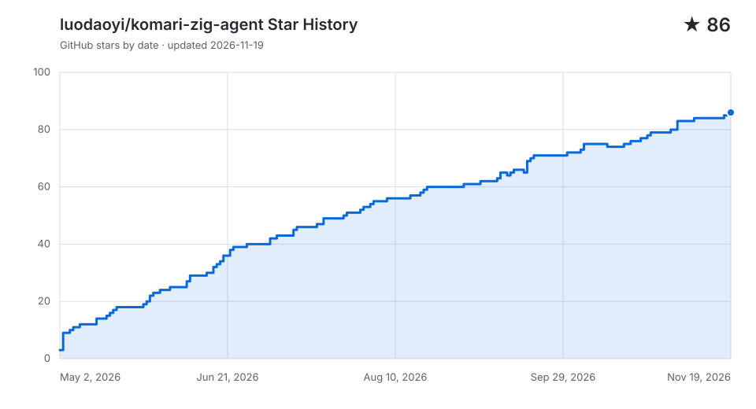

# komari-zig-agent

Zig 版 `komari-agent`，目标是直接替换原 Go agent，并保持 Komari 现有协议、上报字段、任务、Ping、Web SSH、自更新等行为兼容。

## 项目看板

<p>
  <a href="https://github.com/luodaoyi/komari-zig-agent/actions/workflows/build.yml?query=branch%3Amain"></a>
  <a href="https://github.com/luodaoyi/komari-zig-agent/actions/workflows/build.yml?query=branch%3Amain"></a>
  <a href="https://github.com/luodaoyi/komari-zig-agent/actions/workflows/release.yml"></a>
  <a href="https://github.com/luodaoyi/komari-zig-agent/releases/latest"></a>
  <a href="https://github.com/luodaoyi/komari-zig-agent/releases"></a>
  <a href="https://github.com/luodaoyi/komari-zig-agent/releases"></a>
  <a href="https://github.com/luodaoyi/komari-zig-agent/stargazers"></a>
  <a href="https://github.com/luodaoyi/komari-zig-agent/issues"></a>
</p>

<p>
  
  
  
  
  
  
</p>

这些 SVG 徽章由 GitHub Actions 与 Shields.io 按仓库实时状态生成；构建、覆盖率门禁、Release、下载量、Star、Issue 会随仓库变化自动更新。

## 状态

- 历史兼容基线：官方 Go agent `1.2.60` 的启动参数、配置来源、BasicInfo、Report WebSocket、任务执行、Ping、Web SSH、自动发现、代理、自定义 DNS/IP、自更新、安装和替换脚本均已实现；继续保留可选 Cloudflare Access 凭据支持。
- 既有上游增量：已吸收 `Snapshot-2607270914` 的非 root systemd user 安装和 Windows NVIDIA 详细 GPU 指标，并继续支持更早加入的 Linux `loong64` 构建与安装。
- NVIDIA 温度保留小数：启用 GPU 上报前，服务端需先升级至 `1.6.2` 或其他已包含浮点温度支持的版本（上游 `komari-monitor/komari#710`）。旧版整数解码器无法接收小数温度，可能拒绝整份报告；请先升级服务端，暂不能升级时保持 GPU 上报关闭。整数温度仍输出整数 JSON；负数、不可用或非有限温度按 `0` 回退。暂不支持自动协商服务端能力，升级本 agent 不会升级服务端。
- 支持系统：Linux、FreeBSD、macOS、Windows；Linux 覆盖 Debian/Ubuntu/Kali、Fedora/CentOS Stream/Rocky/Alma、OpenWrt、Raspberry Pi OS profile、Synology DSM profile。
- Release 资产：自动构建 20 个二进制，其中 Linux 11 架构：`amd64`、`arm64`、`386`、`arm`、`mips`、`mipsel`、`mips64`、`mips64el`、`riscv64`、`s390x`、`loong64`。
- 自动化测试：Ubuntu、macOS、Windows 原生单测；Debian/Ubuntu/Kali 和红帽系容器单测；FreeBSD VM 单测；OpenWrt、Raspberry Pi OS、Synology DSM profile 与主流 Linux 发行版 agent 启动烟测；Linux 多架构 QEMU agent 启动烟测。
- 测试覆盖率：GitHub Actions 使用 kcov 强制 `100.00%` 行覆盖率门槛。
- 安全情况：Release 产物生成 `SHA256SUMS`；安装、替换、纯二进制更新、自更新均校验下载内容；下载、校验或预检失败不会覆盖原二进制；CI 使用固定版本 Zig 与固定哈希下载，主要 GitHub actions 固定到提交 SHA。
- 兼容范围：按下方版本对应和已实现功能说明，不承诺与最新上游全部功能等价；CI 通过也不等于全部真实部署场景已验证。
- Zig：0.16.0。
- 服务端原项目：`komari-monitor/komari`，仓库地址 <https://github.com/komari-monitor/komari>。
- Agent 兼容目标：`komari-monitor/komari-agent` 协议，原 Agent 仓库 <https://github.com/komari-monitor/komari-agent>。
- 发布仓库：`luodaoyi/komari-zig-agent`。
- 自更新：检查本仓库 GitHub Release，不再下载原 Go 仓库版本。

## 版本对应与升级顺序

| 本仓库版本 | 对应上游 | 本次对齐范围 |
| --- | --- | --- |
| [Zig agent v0.1.55](https://github.com/luodaoyi/komari-zig-agent/releases/tag/v0.1.55) | [Go Agent 1.6.20](https://github.com/komari-monitor/komari-agent/releases/tag/1.6.20) 中的 [#139](https://github.com/komari-monitor/komari-agent/pull/139) | 仅 NVIDIA 小数温度采集与 JSON 上报行为，不代表移植 1.6.20 的全部更新。 |
| GPU 小数温度的服务端前提 | [Komari Server 1.6.2](https://github.com/komari-monitor/komari/releases/tag/1.6.2) 中的 [#710](https://github.com/komari-monitor/komari/pull/710) | 首个包含该修复的稳定版本；温度解码、存储及历史接口保留小数。 |

先升级服务端，再升级/启用 GPU 上报。旧版服务端可能拒绝包含小数温度的整份报告；不能升级服务端时保持 GPU 上报关闭。整数温度和异常值回退 `0` 保留整数 JSON token，但这不代表小数报告兼容旧服务端。当前未自动协商服务端 GPU 能力。

Linux Agent 连接支持终端恢复协议的 Komari 服务端（正式版 1.6.2 起）时，Web SSH 在暂时断线后会尝试连接回同一个终端会话，不会新开 shell。断线会话保留窗口为 5 分钟；主动退出或收到服务端明确拒绝后不会再重连。其他平台和旧服务端仍可使用原有 Web SSH，不承诺断线后恢复同一会话。

本项目不计划支持远程文件浏览、上传、下载或管理；Web SSH 不受此限制。本页的 `1.2.60` 是历史功能基线，下方 `1.2.13` 是历史性能测试版本，均不是当前上游最新版本声明。

## 相较官方 Go Agent 的特点

- 资源占用：下方保留与 Go Agent 1.2.13 的历史测量供参考；未据此宣称 v0.1.55 相比 Go Agent 1.6.20 的体积或性能优势。
- 更快上报：Linux 热路径主要读 `/proc` 与原生 syscall；FreeBSD/macOS 已去除采样中的固定 1 秒阻塞；上报间隔不再被采样等待拖长。
- 更稳运行：WebSocket 写入加锁并分块 mask；服务端任务设并发上限，避免 ping、exec、terminal 任务过多压垮 agent。
- 更安全更新：安装、替换、纯二进制更新、自更新均校验 SHA256；自更新流式落盘后校验，下载或校验失败不覆盖原二进制。安装/替换/update-binary 脚本不保留原二进制备份，也不自动回滚；替换后启动失败需要人工处理。
- 更适合国内网络：安装、替换、纯二进制更新、自更新支持 GitHub 代理池，可显式指定代理，减少国内机器拉取失败。
- 更广兼容：保持官方 Go agent 参数和 Komari 协议兼容，同时发布 Linux 11 架构及 Windows、FreeBSD、macOS 资产。
- 更严测试：CI 覆盖多发行版、多架构、FreeBSD、OpenWrt/RPiOS/Synology profile，单测覆盖率门禁为 `100.00%`。
- 更低运维风险：Release 产物有 `SHA256SUMS`，CI 固定 Zig 版本与下载哈希，脚本先预检二进制再替换服务。

## 性能对比（历史参考）

以下为早期版本的留存测量，未重新测量 v0.1.55 与 Go Agent 1.6.20；表中体积、内存和结论不能作为当前版本的性能承诺。

测试环境：

- 系统：Debian Linux 6.1 x86_64。
- Go 版：官方 `komari-monitor/komari-agent` 1.2.13，linux-amd64。
- Zig 版：本仓库 ReleaseSmall，linux-amd64。
- 两者使用同一 Komari 配置。Go 版测试时关闭自更新，避免测试过程中切换版本。

| 指标 | 原 Go agent | Zig agent | 结果 |
| --- | ---: | ---: | --- |
| linux-amd64 二进制大小 | 8,585,378 B | 702,488 B | Zig 约小 12.2 倍 |
| 常驻 RSS | 17,828 KB | 约 1,196 KB | Zig 约低 93% |
| systemd 当前内存记账 | 未记录 | 约 644 KB | 低于 1 MB |
| 私有脏页 | 未记录 | 约 504 KB | 堆与可写私有页很低 |
| 线程数 | 9 | 4 | Zig 更少 |
| CPU | 约 0.6% | 约 0.1% | Zig 更低 |

结论：

- Zig 版 `ps` RSS 已约 1.2 MB；systemd 当前内存记账低于 1 MB。
- CPU 没有靠降低上报频率换取；采样等待、WebSocket 上报节奏和协议字段保持不变。
- 上报 JSON、月流量采样、`/proc` 热路径已尽量改为栈缓冲，减少重复堆申请。
- 二进制体积明显小，适合 OpenWrt、小内存 VPS、低端 ARM/MIPS 设备。

## 一键替换原 Go Agent

已经装了默认服务名为 `komari-agent` 的官方 Go Agent？直接执行下面一条命令即可替换为 Zig 版。原有的面板地址、Token 和上报间隔都会保留，无需重新配置。

```sh
curl -fsSL https://raw.githubusercontent.com/luodaoyi/komari-zig-agent/cf513089e2ad32ee5b9a7efae0ea07b68f0e38a1/replace.sh | sudo sh -s -- --version v0.1.55
```

国内网络无法访问 GitHub 时，使用 jsDelivr CDN：

```sh
curl -fsSL https://cdn.jsdelivr.net/gh/luodaoyi/komari-zig-agent@cf513089e2ad32ee5b9a7efae0ea07b68f0e38a1/replace.sh | sudo sh -s -- --version v0.1.55
```

上述命令将脚本固定到 v0.1.55 对应的不可变提交，并通过 `--version v0.1.55` 固定二进制版本；不是下载 latest。启用 GPU 上报前请先满足上述服务端版本要求。

脚本会自动识别 CPU 架构，下载匹配的 Release，校验 `SHA256SUMS` 并执行二进制预检，替换后重启原服务。不备份原 Agent，也不自动回滚：下载、校验或预检失败时原 Agent 保持不变；替换后启动或健康检查失败则报错退出，保留新二进制。

安装脚本（`install.sh` / `install.ps1`）和 `update-binary.sh` 同样不保留原 Agent 备份。脚本不会清理以往版本遗留的备份文件。

> 适用于 Linux 和 OpenWrt 的已有 Go Agent 安装。自定义服务名、Windows、首次安装、指定版本或自定义路径等高级场景，请查看脚本参数或 GitHub Release。

## 更新已有 Zig Agent（固定 v0.1.55）

适用于 Linux 上默认服务名 `komari-agent` 的既有安装；保留原面板地址、Token 和启动配置，更新二进制后重启服务。自定义服务名/路径时可传 `--service` / `--binary`。

```sh
curl -fsSL https://raw.githubusercontent.com/luodaoyi/komari-zig-agent/cf513089e2ad32ee5b9a7efae0ea07b68f0e38a1/update-binary.sh | sudo sh -s -- --version v0.1.55
```

脚本源码和目标二进制均固定在 v0.1.55；会校验 `SHA256SUMS`，但不备份、不自动回滚。此命令不升级服务端，启用 GPU 上报前仍需先升级至支持小数温度的服务端。

## 自更新

Agent 启动后会检查：

```text
https://api.github.com/repos/luodaoyi/komari-zig-agent/releases/latest
```

若发现更高版本，会下载与当前平台匹配的资产，例如：

```text
komari-agent-linux-amd64
komari-agent-linux-arm64
komari-agent-linux-386
komari-agent-linux-arm
komari-agent-linux-mips
komari-agent-linux-mipsel
komari-agent-linux-mips64
komari-agent-linux-mips64el
komari-agent-linux-riscv64
komari-agent-linux-s390x
komari-agent-linux-loong64
komari-agent-freebsd-amd64
komari-agent-freebsd-arm64
komari-agent-freebsd-386
komari-agent-freebsd-arm
komari-agent-darwin-amd64
komari-agent-darwin-arm64
komari-agent-windows-amd64.exe
komari-agent-windows-arm64.exe
komari-agent-windows-386.exe
```

自更新同样优先直连 GitHub；Release API、二进制资产、`SHA256SUMS` 任一步直连失败，都会按内置代理池回退。可用 `KOMARI_GITHUB_PROXIES` 覆盖代理池，多个代理可用空格、逗号或分号分隔：

```sh
KOMARI_GITHUB_PROXIES="https://gh.llkk.cc https://gh-proxy.com https://ghproxy.net"
```

下载完成后会校验 GitHub Release API 的 `digest`；若 API 未返回 digest，则使用同 Release 的 `SHA256SUMS`。校验失败不会替换本机二进制。

可用参数关闭自更新：

```sh
--disable-auto-update
```

## 构建

本机构建：

```sh
zig build -Doptimize=ReleaseSmall -Dversion=dev
```

构建指定平台：

```sh
zig build -Dtarget=x86_64-linux-musl -Doptimize=ReleaseSmall -Dversion=dev
```

全平台构建：

```sh
./build_all.sh
```

Windows PowerShell：

```powershell
.\build_all.ps1
```

## 注释与文档

生产源码的注释覆盖率已纳入仓库门槛，统计范围为 `src/**/*.zig`，排除 `*_test.zig`，要求至少 `80%` 的源码文件带有 Zig 文档注释 `//!` 或 `///`。细则见 `docs/code-comments.md`。

本地可直接执行：

```sh
python3 scripts/check_comment_coverage.py src 80
```

## Release CI/CD

自动发布有两种方式：

1. 推送 tag：先设置 `VERSION` 为尚未使用的新版本号（`vX.Y.Z` 格式），不要复用或移动已发布标签。

```sh
: "${VERSION:?请先设置新的未使用版本号}"
git tag -a "$VERSION" -m "Release $VERSION"
git push origin "refs/tags/$VERSION"
```

2. GitHub Actions 手动发布：

```text
Actions -> Release -> Run workflow -> 输入新的未使用版本号（vX.Y.Z 或 X.Y.Z）
```

Action 会自动：

- 规范化 tag 为 `vX.Y.Z`。
- 手动触发时创建并推送 tag。
- 编译 Linux 11 架构、FreeBSD、macOS、Windows 多平台二进制。
- 创建 GitHub Release。
- 上传所有 Release 资产。
- 生成并上传 `SHA256SUMS`，供安装脚本、替换脚本和 Agent 自更新校验下载内容。

## Star History

<a href="https://github.com/luodaoyi/komari-zig-agent/tree/star-history">
  
</a>

图表由仓库自身的 GitHub Actions 每日更新；历史数据和 SVG 保存在独立的 `star-history` 分支，不依赖第三方图表服务。

## 验证

```sh
zig build test
zig build -Dtarget=x86_64-linux-musl -Doptimize=ReleaseSmall
zig build -Dtarget=s390x-linux-musl -Doptimize=ReleaseSmall
zig build -Dtarget=loongarch64-linux-musl -Doptimize=ReleaseSmall
zig build -Dtarget=x86_64-freebsd -Doptimize=ReleaseSmall
zig build -Dtarget=aarch64-macos -Doptimize=ReleaseSmall
```
